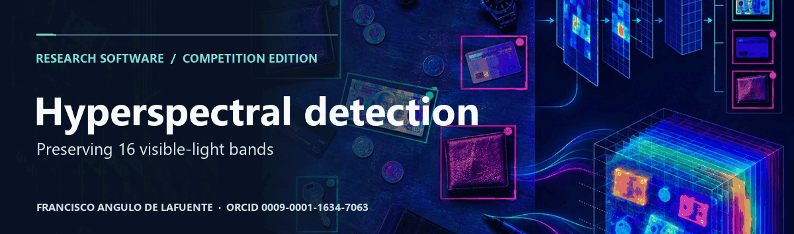
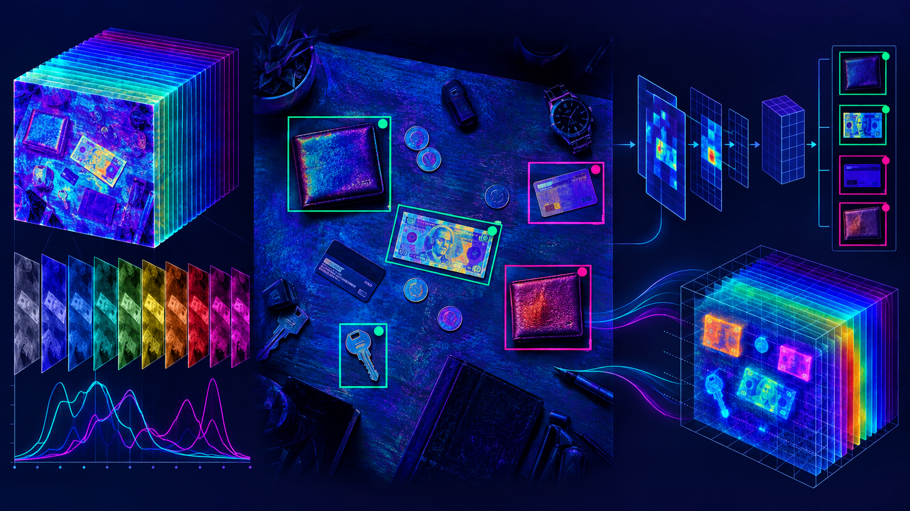
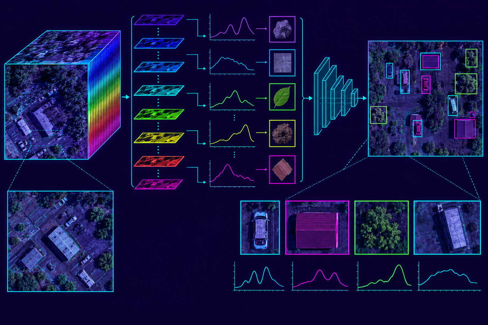
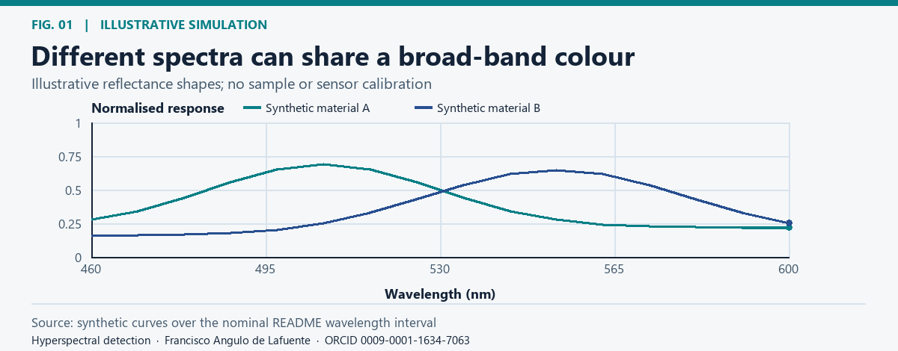
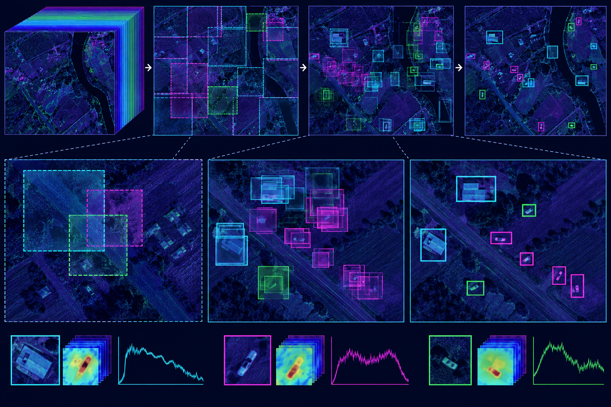
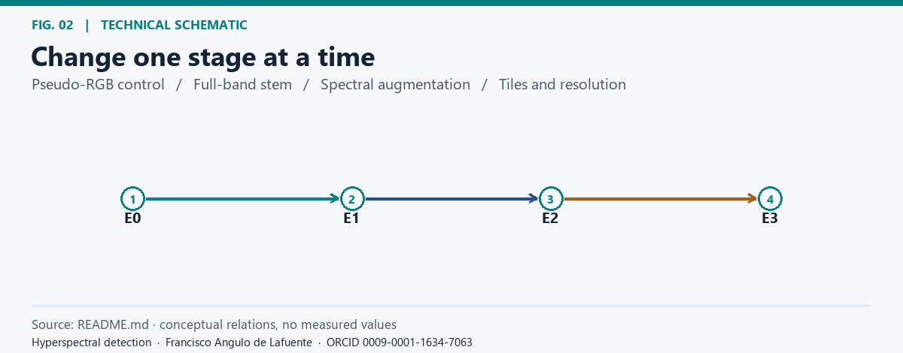
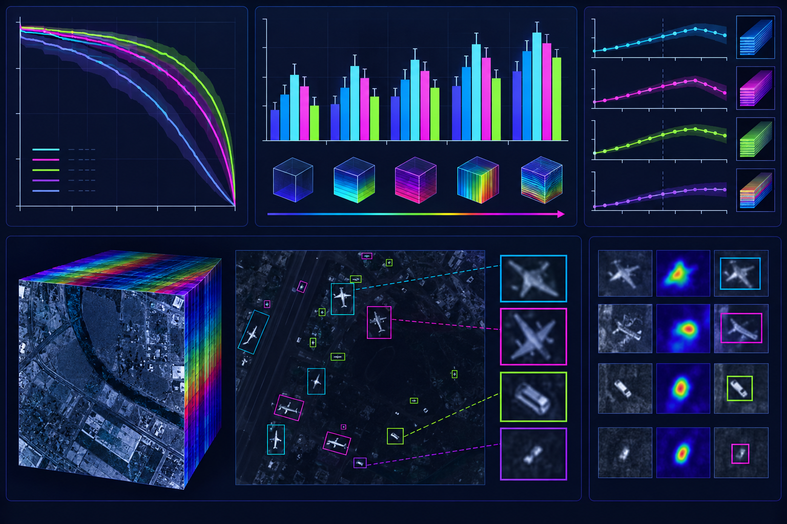
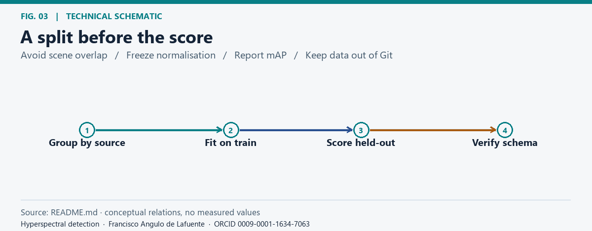
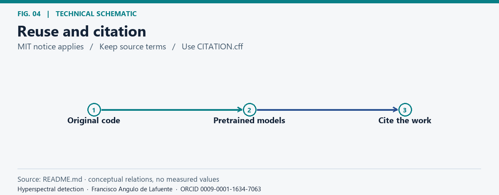
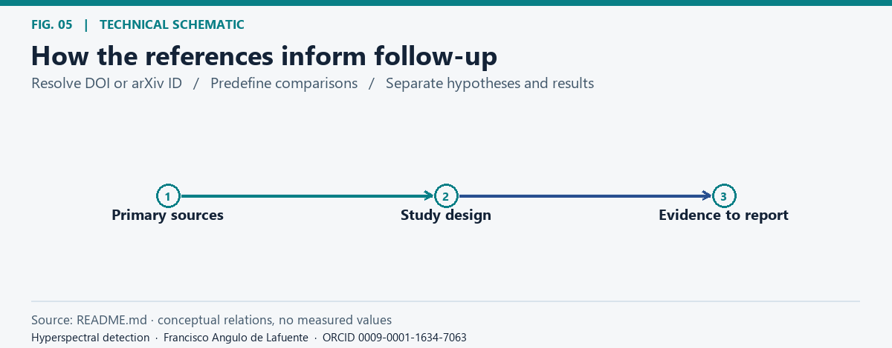

# Hyperspectral Object Detection Challenge 2026




**Project citation:** [Francisco Angulo de Lafuente](https://orcid.org/0009-0001-1634-7063) · [CITATION.cff](CITATION.cff) · [Software metadata](codemeta.json).




An open-source, reproducible reference pipeline for [Hyperspectral Object Detection Challenge 2026](https://www.kaggle.com/competitions/hyperspectral-object-detection-challenge-2026). The design keeps all 16 visible-light bands (460–600 nm), predicts 18 classes, and targets the official `mAP@[0.50:0.95]` metric.



<!-- impact-note:start -->
<sub><strong>Efficiency and practical value.</strong> The proposed spectral stem retains all sixteen bands while adapting pretrained RGB features, aiming to reuse existing visual representations without discarding the additional spectral measurements. Its staged experiments isolate the value of spectral processing, augmentation and tiled inference before spending more computation. The <a href="#design">design and experiment ladder</a> define this opportunity; measured gains require matched validation.</sub>
<!-- impact-note:end -->

## Design



*Different spectra can share a broad-band colour.* [Static figure](docs/figures/fig-01.png).


```text
H x W x 16 cube -> train-only band normalization
    -> spectral stem -> CSP/FPN/PAN detector -> class-wise NMS
    -> optional TTA from the same network -> submission.csv
```

The spectral stem uses a 1x1 projection followed by spatial convolutions so pretrained RGB features can be inflated without silently discarding spectral information. The pseudo-RGB route remains a control experiment only.



## Experiment ladder



*Change one stage at a time.* [Static figure](docs/figures/fig-02.png).


1. `E0`: pseudo-RGB detector for labels, boxes, and submission-contract checks.
2. `E1`: 16-band detector with an inflated RGB initialization.
3. `E2`: spectral dropout, per-band intensity jitter, and spatial augmentation.
4. `E3`: high-resolution or tiled inference, selected only when a subject-safe validation split improves.



## Reproducibility and rules



*A split before the score.* [Static figure](docs/figures/fig-03.png).


Competition data and generated weights are excluded from this public release. Use only data and pretrained models permitted by the current rules, record their sources and licenses, and validate the exact `submission.csv` schema. A local score is not evidence of real-world remote-sensing performance.

## License



*Reuse and citation.* [Static figure](docs/figures/fig-04.png).


MIT for the original code. See [LICENSE](LICENSE). External datasets, pretrained backbones, and dependencies retain their own licenses.

## Bibliography and research directions



*How the references inform follow-up.* [Static figure](docs/figures/fig-05.png).


The following primary sources inform proposed checks. Their text, code, figures, and data are not included in this documentation update.

- [Lin et al. (2017), Feature Pyramid Networks for Object Detection](https://arxiv.org/abs/1612.03144). Compare spectral stems at identical scales and use a fixed pyramid to isolate the effect of added bands.
- [Redmon and Farhadi (2018), YOLOv3: An Incremental Improvement](https://arxiv.org/abs/1804.02767). Use multiscale detection as background; ablate tiling against a fixed detector and report errors by object size.

**Attribution and reuse.** Please credit [Francisco Angulo de Lafuente](https://orcid.org/0009-0001-1634-7063) in academic and software reuse and do not present this work as your own. When distributing copies or substantial portions of the original MIT software, preserve the copyright and permission notice. Upstream material keeps its own terms. [License](LICENSE) · [Figure methods and provenance](docs/figures/README.md).

<!-- research-provenance: project=hyperspectral-object-detection-2026; date=2026-11-04; author=Francisco Angulo de Lafuente; orcid=https://orcid.org/0009-0001-1634-7063; original-software-license=MIT -->
